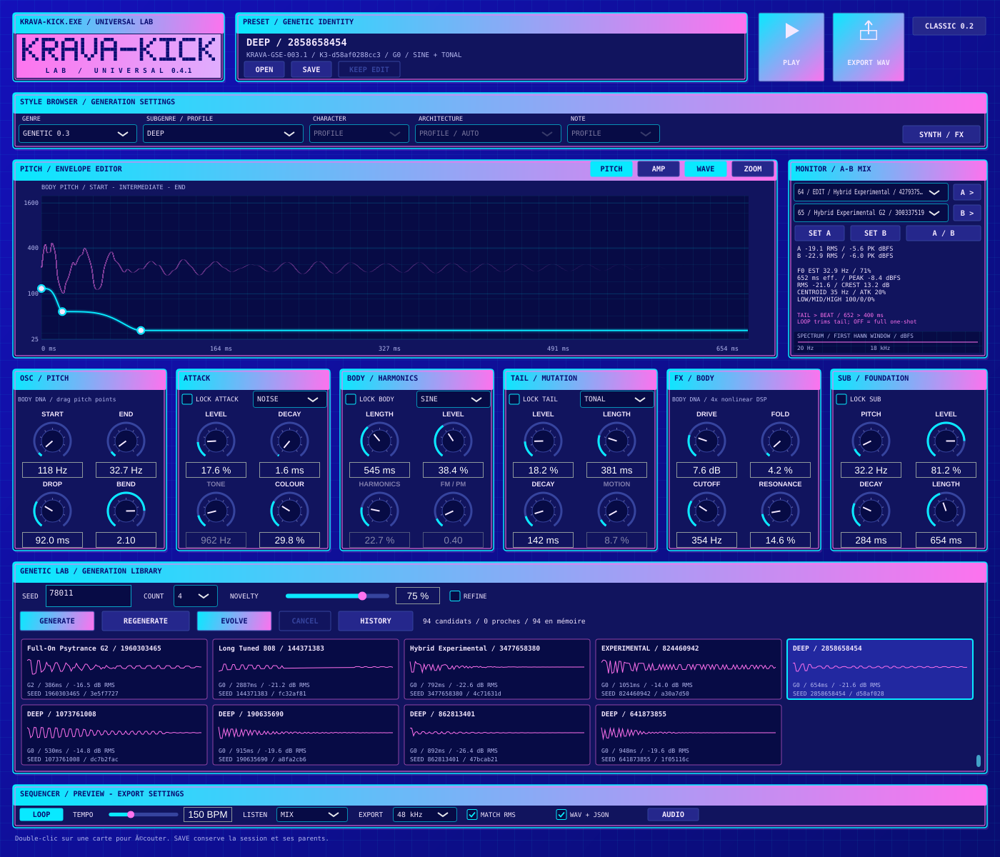

# KRAVA-KICK LAB — 0.4.1

Premier ensemble **Universal Kick Engine** : huit profils musicaux, six points de départ d'architecture et un moteur génétique reproductible. Application autonome C++20/JUCE pour Windows x64. L'identité bleu quadrillé/rose/cyan est conservée.



## Ouvrir et écouter

1. Ouvre la dernière exécution réussie **Windows universal lab 0.4** dans [GitHub Actions](https://github.com/emilien-behague/Kravatek/actions).
2. Télécharge **KRAVA-KICK-LAB-Windows-x64** dans Artifacts, en étant connecté à GitHub. Décompresse et ouvre **KravaKickLab.exe**.
3. **OPEN → Examples/Universal/reference.session.json** charge 24 sons des huit profils pour comparaison immédiate. Désactive LOOP pour les longues tails.

Le [guide en français](docs/WINDOWS-GUIDE.md) décrit les commandes sans programmation. Le [rapport de validation](docs/VALIDATION.md) précise le build réellement vérifié et les essais restant à faire sur ton PC.

## Profils opérationnels

| Famille | Profil de ce premier ensemble | Principaux choix DSP |
| --- | --- | --- |
| House | Classic House | Sine/additif discret, attaque tonale, saturation douce, sub contrôlé |
| Techno | Classic Techno | Corps additif, transient harmonique, enveloppe de drive et tail gated |
| Psytrance | Full-On Psytrance | Pitch rapide à point intermédiaire, phase contrôlée, durées courtes |
| Hard Techno | Driven Hard Techno | Harmoniques/FM, asymétrie, double saturation et multibande |
| Hardstyle | Tonal Hardstyle | Saw PolyBLEP/additif, tail tonale gated et harmoniques |
| Hardcore | Driven Hardcore | Saw/FM, hard clip, multibande et transitoire hybride |
| 808 / Hip-hop | Long Tuned 808 | Sub dominant, glide, accordage et décroissances longues |
| Experimental | Hybrid Experimental | Ring/FM/membrane, quantification/sample hold, tail modulée |

Les probabilités de modules et les plages varient selon le profil ; le genre guide la génération sans imposer un timbre unique. L'architecture forcée et les caractères permettent d'en sortir. La membrane synthétique est aussi accessible par **HYBRID / ACOUSTIC** ; aucune reproduction acoustique parfaitement réaliste n'est revendiquée.

## Générer, transformer et conserver

Choisir GENRE / PROFILE, CHARACTER, ARCHITECTURE ou NOTE rend et écoute immédiatement **un candidat** ; le mode GENETIC 0.3 fait de même. La 0.4.1 corrige le navigateur auparavant limité aux prochaines générations et le lecteur qui pouvait conserver l'ancien buffer. Le précédent son reste dans HISTORY. Changer de famille rétablit CHARACTER / ARCHITECTURE / NOTE sur PROFILE / AUTO. Les DNA LOCK sont respectés par cet aperçu.

Règle NOVELTY et COUNT, puis GENERATE pour 4/8/12/20 nouveaux candidats en arrière-plan ; CANCEL agit entre candidats. GENERATE reste libre des verrous ; EVOLVE les applique au parent sélectionné. La lecture en boucle suit la nouvelle sélection, y compris par simple clic sur une carte. REGENERATE utilise une nouvelle graine déterministe. Sélectionne un parent et active les quatre verrous avant EVOLVE. Les couches verrouillées conservent exactement leurs gènes et leurs buffers isolés, même en provenance de la 0.3.

PITCH/AMP et les six modules éditent le son sélectionné. SYNTH/FX expose les chaînes BODY/TAIL et les contrôles de glide/phase/membrane. KEEP EDIT ajoute un enfant ; les parents restent dans HISTORY. SAVE conserve la bibliothèque (512 états maximum), la filiation et la définition du profil courant. WAV+JSON conserve aussi le contexte de génération avec le son exporté.

A/B compare deux choix de la bibliothèque ; MATCH RMS atténue le plus fort sur 400 ms, sans changer les originaux. Ce n'est pas une mesure LUFS. Le moteur utilise un gain fixe puis une atténuation de sécurité uniquement au-delà de −1 dBFS, sans amplifier tous les candidats à une même crête. LISTEN permet les solos ; l'export contient toujours le mix.

Les longues tails sont autorisées jusqu'à quatre secondes. TAIL > BEAT avertit d'un dépassement : LOOP tronque avec fondu au prochain temps, ONE-SHOT joue la totalité. NOTE utilise une notation MIDI, sans MIDI entrant. L'export mono PCM24 accepte 44,1/48 kHz. La préécoute utilise la fréquence réelle du périphérique.

Les cinq modes GENETIC 0.3 et CLASSIC 0.2 restent disponibles ; les anciens fichiers ne sont pas reconvertis de force. Les versions sont conservées dans Git sous `v0.3.0`, `archive/pre-mission-004` et les tags antérieurs.

## Profils externes et développement

Le catalogue versionné est `profiles/core-004.json`. Le paquet Windows le place dans `Profiles/core-004.json` à côté du programme. Au démarrage, l'application valide ce catalogue ; un fichier invalide déclenche un message et le repli sur le catalogue intégré, généré depuis le même JSON à la compilation. La session conserve un snapshot de sa recette ; changer le catalogue ne change pas les gènes audio déjà sauvegardés. Aucun champ ne peut exécuter du code.

```bash
python3 tools/setup_cloud.py
python3 tools/run_cloud_smoke.py
build-linux/krava-genome-render --list-profiles
build-linux/krava-genome-render --profile 808.long --note 33 --seed 42 --output out/808.wav
build-linux/krava-genome-render --profile house.classic --architecture acoustic --character organic --output out/membrane.wav
python3 tools/validate_genetic_exports.py --renderer build-linux/krava-genome-render --output out/examples-004 --universal
```

Créer `out/` avant les rendus. `--profiles FILE.json` charge un catalogue externe ; `--input SESSION.json --index N` restitue un son sauvegardé. `--help` décrit les options. Le moteur GSE reste accessible avec `--mode`, le moteur Classic avec `krava-render --style`.

Les outils cloud restent locaux à `/workspace/.kravatek-tools` (CMake 3.31.6, Ninja 1.11.1.4, GCC 14.2). JUCE 8.0.16-security reste épinglé à `ea77444750de45e036e0279bb0291144bf8e3688`. Le script prépare Debian 13 sans installation système puis compile et lance les 46 tests. Le smoke test utilise Xvfb/ALSA silencieux : aucune écoute physique. Sans JUCE, le preset `dsp-only` couvre les 36 tests DSP. Les profils JSON utilisent JUCE Core.

Windows : Visual Studio 2022/MSVC v143 + Windows SDK, Git et CMake ≥3.22. `build-windows.cmd` ou les presets `windows-x64` / `windows-release` produisent `build/windows-x64/Release/KravaKickLab.exe`. Utilise simplement l'archive compilée pour jouer. MinGW n'est pas supporté par JUCE. [Licence JUCE : AGPLv3 ou commerciale](https://juce.com/legal/juce-8-licence/).

## Limites et étapes suivantes

Ce premier ensemble n'implémente pas toute la taxonomie de la mission. Les profils UKE spécialisés Schranz/Rawstyle/Gabber/Frenchcore/Uptempo, DnB/Dubstep et les autres genres, l'hybridation pondérée de deux profils et le MIDI entrant restent à développer. Le mode Schranz 0.3 est conservé. Pas d'IA/prompteur connecté, VST3, import de samples, émulation acoustique réaliste garantie ou enveloppes multipoints libres.

Les premiers rendus de préécoute, certains solos et l'édition d'un son peuvent encore bloquer brièvement l'interface. F0 et similarité sont des estimations ; les textures numériques peuvent produire de l'alias volontaire. Les différences mesurées ne prouvent ni qualité musicale ni originalité. L'écoute physique Windows, les dialogues natifs et FL Studio restent à essayer avec le créateur.

Voir [audit, lots et fichiers modifiés](docs/MISSION-004.md), [architecture](docs/ARCHITECTURE.md), [exploration](docs/EXPLORATION.md), [direction visuelle](docs/DESIGN.md) et [validation](docs/VALIDATION.md).
