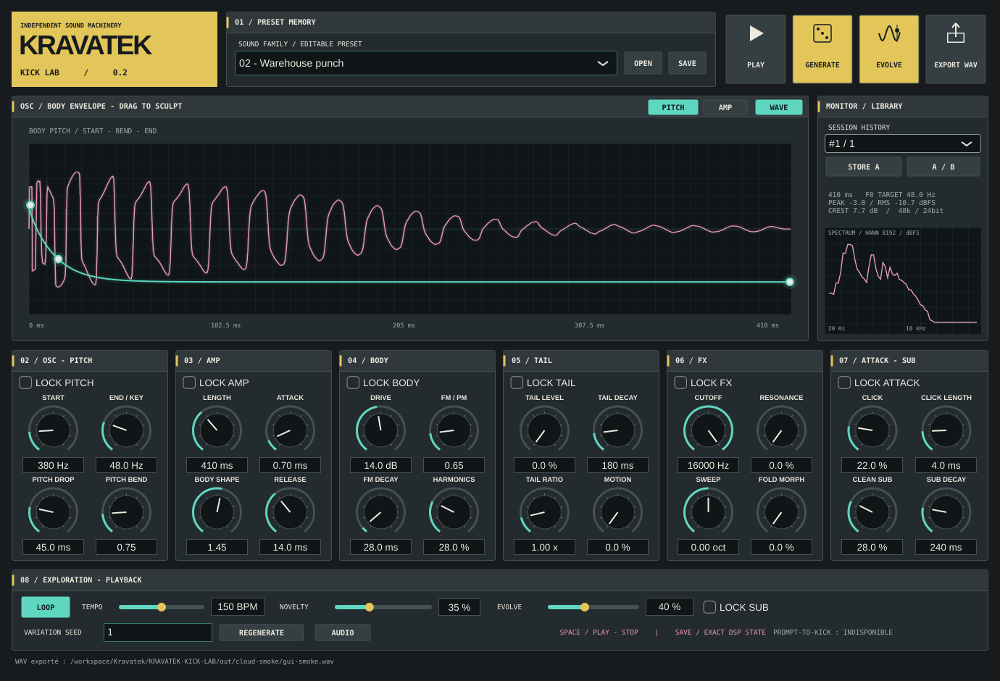

# KRAVATEK KICK LAB — 0.2

**KEEP THE DNA. EVOLVE THE SOUND.**

Instrument autonome de synthèse de kicks pour Windows 10/11 x64, en C++20/JUCE. La 0.2 ajoute un moteur multicouche, 24 paramètres, huit bases sonores, des enveloppes éditables et une exploration reproductible. Aucun sample externe n'est nécessaire.



## Démarrer sous Windows

1. Ouvre [GitHub Actions](https://github.com/emilien-behague/Kravatek/actions), puis la dernière exécution **Windows instrument 0.2** réussie.
2. Télécharge **KRAVATEK-KICK-LAB-Windows-x64** dans **Artifacts**, en étant connecté à GitHub.
3. Décompresse l'archive et double-clique sur **KravatekKickLab.exe**. Aucun code à modifier, aucune installation de JUCE à effectuer.

Le paquet contient l'application, huit WAV d'exemple dans `Examples`, le guide `LIRE-MOI.md` et l'outil développeur `kravatek-render.exe`. Le [rapport de validation](docs/VALIDATION.md) distingue compilations exécutées et vérifications restantes.

## Créer et retrouver un son

| Commande | Action réelle |
| --- | --- |
| Famille | Charge une base fixe : Foundation, Warehouse, Hard Psy, Schranz, Hardcore, Deep, Experimental ou Mutant |
| PLAY / espace | Écoute le rendu ; en LOOP, un deuxième appui arrête |
| PITCH / AMP | Affiche la courbe du body. Glisse les trois points pour régler le pitch ou l'amplitude ; WAVE affiche/masque le rendu final |
| Six modules | Pitch, amplitude, corps harmonique/FM-PM, tail indépendante, filtre/waveshaping, attaque et sub propre |
| GENERATE | Nouvelle base à partir de la famille, de NOVELTY et d'une nouvelle graine |
| REGENERATE | Reproduit famille + graine saisie + NOVELTY ; les éditions manuelles exigent une sauvegarde complète |
| NOVELTY | Ouvre progressivement des régions de paramètres expérimentales ; ce n'est pas une mesure de l'originalité |
| EVOLVE | Transforme le son courant selon son amplitude d'évolution et les groupes DNA déverrouillés |
| LOCK | Conserve le groupe de paramètres pendant EVOLVE. LOCK SUB protège aussi la fréquence finale et la durée totale |
| STORE A puis A/B | Mémorise A ; après une modification, alterne A et B avec RMS de préécoute ajusté sur 400 ms |
| History | Rappelle jusqu'à 24 états de génération de la session ; cette liste n'est pas conservée après fermeture |
| SAVE / OPEN | Sauvegarde/recharge tous les paramètres, graines, verrous, NOVELTY et tempo dans un preset JSON |
| EXPORT WAV | Exporte le son courant en mono PCM 24 bits / 48 kHz, crête −3 dBFS ; choisir un nom `.wav` |
| AUDIO | Choisit/réessaie une sortie audio du système |

Chaque potentiomètre propose une valeur éditable et une infobulle en français. Sur petit écran, des barres de défilement gardent les commandes accessibles. Le spectre, la crête, le RMS et la durée proviennent du signal calculé. **F0 TARGET** est la fréquence finale demandée au moteur, pas une détection automatique de fondamentale.

Le gain A/B concerne uniquement la préécoute. L'export conserve le rendu d'origine. Le RMS ajusté ne constitue pas une mesure LUFS de sonie perceptuelle. Les interactions et la normalisation du mix peuvent modifier le niveau relatif d'une couche dont les paramètres sont verrouillés.

Pour FL Studio : glisse un WAV exporté dans un Sampler ou la Playlist. Cette version est autonome ; elle ne s'installe pas comme VST3.

## Ce qu'il reste à tester avec le créateur

- Comparer Deep, Hard Psy, Schranz, Experimental et Mutant sur la même écoute et dans un morceau.
- Vérifier la place du kick Hard Psy avec une bassline rapide et la netteté du grave Deep.
- Verrouiller SUB et ATTACK, faire évoluer la tail, puis comparer A/B.
- Sauvegarder un son modifié, le rouvrir et exporter vers FL Studio.
- Vérifier la sortie audio et le dialogue natif d'export sur le PC Windows.

PROMPT-TO-KICK est explicitement indisponible. Enveloppes multipoints libres, import de samples, banque persistante, traitement multibande et plugin restent des développements futurs. Aucune équivalence avec un produit commercial ni validation subjective de qualité sonore n'est revendiquée.

## Architecture et validation

L'[audit de la 001](docs/AUDIT-002.md) explique les limites et le périmètre retenu. L'[architecture DSP](docs/ARCHITECTURE.md), le [contrat d'exploration](docs/EXPLORATION.md) et la [direction graphique](docs/DESIGN.md) détaillent ce qui fonctionne réellement.

Le moteur conserve une référence sinusoïdale propre, ajoute FM/PM, harmoniques, bruit d'attaque, saturation tanh/sine-fold suréchantillonnée, tail modulée, filtre résonant à topologie préservée et sub à fréquence fixe. Le callback audio utilise des buffers préalloués, sans allocation ni verrou.

## Développer dans le cloud

Depuis `/workspace/Kravatek/KRAVATEK-KICK-LAB` :

```bash
python3 tools/setup_cloud.py
python3 tools/run_cloud_smoke.py
```

Les outils sont installés localement dans `/workspace/.kravatek-tools`. Le premier script compile puis lance les 22 tests. Le second utilise temporairement Xvfb et une sortie ALSA silencieuse, vérifie les interactions et produit `out/cloud-smoke/gui-smoke.json` et `prototype-002.png`. Il n'effectue aucune écoute physique.

Sans interface/JUCE :

```bash
cmake --preset dsp-only
cmake --build --preset dsp-release
ctest --preset dsp-release
```

Rendu par le même moteur :

```bash
build-linux/kravatek-render --style deep --seed 1 --output out/deep.wav
build-linux/kravatek-render --style mutant --seed 424242 --novelty .85 --tail .7 --output out/mutant.wav
build-linux/kravatek-render --help
```

Les temps de la CLI sont en millisecondes ; niveaux, morphs et NOVELTY sont en unités 0..1. Les paramètres complets sont inscrits dans les métadonnées du WAV. La reproductibilité binaire concerne une même plateforme et les mêmes conditions mathématiques.

## Compiler Windows localement

Prérequis : Visual Studio 2022, charge **Développement Desktop en C++**, MSVC v143, Windows SDK, Git et CMake ≥3.22. Double-cliquer sur `build-windows.cmd` ; le résultat est `build/windows-x64/Release/KravatekKickLab.exe`. Ces outils ne sont pas installés automatiquement sur le PC.

```powershell
cmake --preset windows-x64
cmake --build --preset windows-release
ctest --preset windows-release
```

Versions : JUCE **8.0.16-security**, commit `ea77444750de45e036e0279bb0291144bf8e3688` ; CMake **3.31.6**, Ninja **1.11.1.4**, GCC **14.2** pour ce cloud. MinGW n'est pas supporté par JUCE. La version 001 reste dans Git sous `archive/prototype-001`.

JUCE relève de sa licence AGPLv3 ou commerciale : [conditions JUCE 8](https://juce.com/legal/juce-8-licence/). Aucun choix de licence pour les sources propres à KRAVATEK n'est ajouté ici.
