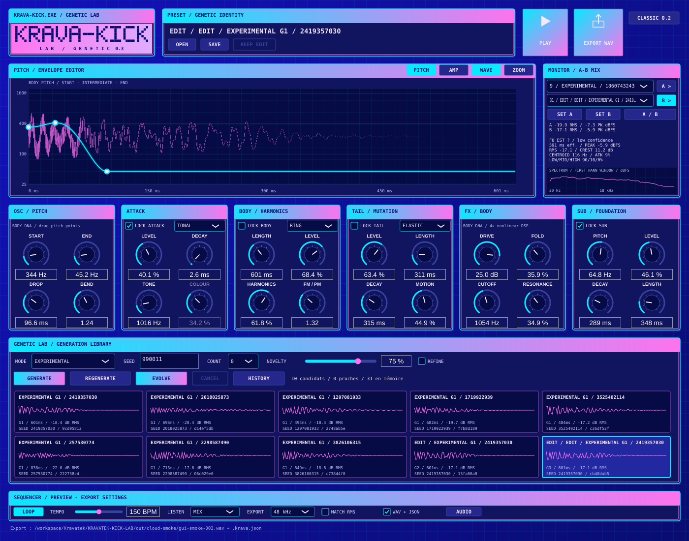

# KRAVA-KICK LAB — 0.3

**KEEP THE DNA. EVOLVE THE SOUND.**

Instrument autonome de synthèse de kicks pour Windows 10/11 x64, en C++20/JUCE. Le moteur génétique ajoute quatre couches réellement indépendantes, cinq modes de génération, des populations reproductibles et une bibliothèque avec parents/enfants. Aucun sample externe n'est nécessaire. L'ancien moteur reste accessible dans CLASSIC 0.2.



## Ouvrir sous Windows

1. Ouvre [GitHub Actions](https://github.com/emilien-behague/Kravatek/actions), puis la dernière exécution **Windows genetic lab 0.3** réussie.
2. Dans **Artifacts**, télécharge **KRAVA-KICK-LAB-Windows-x64**, en étant connecté à GitHub.
3. Décompresse l'archive et ouvre **KravaKickLab.exe**. Aucun code à écrire, aucune installation de JUCE.

Le paquet contient l'application, `LIRE-MOI.md`, les outils CLI et les exemples WAV avec paramètres associés. Le [rapport de validation](docs/VALIDATION.md) précise l'exécution réellement vérifiée et ce qui reste à essayer sur ton PC.

## Ton premier parcours génétique

1. Dans GENETIC LAB, choisis **EXPERIMENTAL**, **NOVELTY 75 %**, **COUNT 20** puis **GENERATE**.
2. Double-clique sur les cartes pour écouter. Sélectionne ton préféré.
3. Active **LOCK SUB** et **LOCK ATTACK**, règle **COUNT 8**, puis **EVOLVE**.
4. Sélectionne une variante. **SET A** et **SET B** assignent deux sons ; **A >**, **B >** ou **A/B** les jouent. Active **MATCH RMS** pour ajuster les niveaux de préécoute ; désactive-le pour entendre les niveaux réels.
5. **SAVE** conserve la bibliothèque et sa filiation. **EXPORT WAV**, avec **WAV + JSON** activé, enregistre le mix et ses paramètres reproductibles. Glisse le WAV dans FL Studio.

## Commandes et garanties

| Commande | Action réelle |
| --- | --- |
| GENERATE | Lot de 4/8/12/20 nouveaux kicks, selon mode, graine saisie et NOVELTY |
| REGENERATE | Nouveau candidat avec la graine suivante dérivée de façon déterministe ; mode et NOVELTY conservés |
| EVOLVE | Variantes du kick sélectionné ; parent conservé, graines effectives et provenance sauvegardées |
| NOVELTY | Intensité graduelle de l'exploration, pas un pourcentage d'originalité |
| REFINE | Variations plus petites, architectures conservées, sans rejet des sons proches |
| DNA LOCK | EVOLVE conserve exactement gènes et signal isolé des couches cochées ; l'édition manuelle reste possible |
| PITCH / AMP | Trois poignées pilotent les vrais calculs du BODY, dont un point de pitch intermédiaire |
| Six modules | Pitch, transient, architecture/harmoniques, tail, saturation/filtre BODY et sub indépendant |
| KEEP EDIT | Ajoute l'édition comme enfant sans écraser l'original ; SAVE/EXPORT/EVOLVE le font aussi automatiquement |
| LISTEN | Mix ou couche isolée avec forme d'onde correspondante ; l'export reste le mix complet |
| HISTORY | Retrouve parents et lots précédents, jusqu'à 512 états persistants par session |
| OPEN / SAVE | Charge/conserve la session complète : gènes, graines, verrous, filiation, sélections A/B et réglages |
| EXPORT WAV | Mono PCM 24 bits à 44,1 ou 48 kHz ; paramètres exacts intégrés, JSON associé en option |
| LOOP / PLAY / espace | Écoute au tempo ; nouvel appui arrête la boucle |
| CANCEL | Arrête le lot entre deux candidats et conserve les résultats déjà calculés |
| CLASSIC 0.2 | Retrouve les anciennes familles/fonctions ; OPEN reconnaît leurs presets automatiquement |

Les paramètres sans effet pour l'architecture sélectionnée sont désactivés. Les valeurs sont éditables au clavier. Sur petit écran, utilise les barres de défilement. Le spectre, le RMS, la crête et les formes d'onde proviennent de l'audio calculé ; F0 EST est une estimation avec confiance, pas une certitude pour une texture complexe.

Le nouveau moteur n'amplifie pas tous les kicks à une même crête : gain commun fixe et atténuation de sécurité au-delà de −1 dBFS uniquement. A/B ajuste le RMS sur 400 ms, pas la sonie LUFS. Le gain de préécoute ne modifie aucun fichier. Les interactions du mix peuvent modifier la perception d'une couche verrouillée, même si son signal isolé est inchangé.

Les quatre couches disposent d'enveloppes, phases et graines indépendantes. Le BODY explore sine/additif/FM-PM/ring ; les transitoires bruit/tonal/harmonique/hybride ; les tails tonale/élastique/résonante/phase warp. Les cinq modes ont leurs propres distributions. Les candidats très proches peuvent déclencher jusqu'à quatre propositions déterministes ; les descripteurs ne constituent pas une preuve de qualité ou d'originalité.

## Limites et essais musicaux

Teste le poids du sub, la netteté de l'attaque, la place avec ta basse et l'intérêt des mutations sur ton écoute. La sortie Windows, les dialogues natifs et l'import FL Studio doivent être essayés sur ton PC. Le cloud utilise une sortie silencieuse.

Les lots sont en arrière-plan ; certains premiers rendus de préécoute/solos et l'édition d'un son restent synchrones. Les courbes sont paramétriques, pas multipoints libres. Le prompteur/IA, VST3, import de samples et traitements multibandes ne sont pas développés. L'exactitude binaire exige même moteur, fréquence, plateforme et conditions mathématiques.

L'[audit et le suivi des lots](docs/MISSION-003.md), l'[architecture](docs/ARCHITECTURE.md), le [contrat d'exploration](docs/EXPLORATION.md) et la [direction graphique](docs/DESIGN.md) décrivent les garanties et limites. Les anciennes versions sont conservées dans Git, notamment `archive/pre-mission-003` et `v0.2.0`.

## Développer dans le cloud

Depuis `/workspace/Kravatek/KRAVATEK-KICK-LAB` :

```bash
python3 tools/setup_cloud.py
python3 tools/run_cloud_smoke.py
```

Les outils sont locaux dans `/workspace/.kravatek-tools`. Le premier script prépare les dépendances Debian 13, compile et exécute les 35 tests. Le second teste réellement l'application sous Xvfb/ALSA silencieux, dont le parcours 20 kicks puis 8 mutations ; rapports dans `out/cloud-smoke/`, capture `instrument-003.png`. Il ne valide aucune écoute physique.

```bash
mkdir -p out
build-linux/krava-genome-render --mode experimental --seed 778899 --novelty .75 --batch 20 --output out/kick.wav
build-linux/krava-genome-render --input out/kick.session.json --index 0 --output out/recalled.wav
build-linux/krava-render --style deep --seed 1 --output out/classic-deep.wav
```

`krava-genome-render` écrit WAV, `.krava.json` et `.session.json`. La graine seule ne conserve pas les éditions ni toute une filiation ; sauvegarder les paramètres complets. `--help` décrit les options. Le build sans JUCE (`cmake --preset dsp-only`, build/ctest `dsp-release`) couvre les 30 tests DSP ; la persistance et les outils génétiques JSON utilisent JUCE Core.

## Compiler Windows localement

Visual Studio 2022 avec **Développement Desktop en C++**, MSVC v143, Windows SDK, Git et CMake ≥3.22 sont nécessaires au développement local. Double-clique `build-windows.cmd`, ou utilise les presets `windows-x64` / `windows-release`. Résultat : `build/windows-x64/Release/KravaKickLab.exe`. Tu peux simplement utiliser l'archive déjà compilée à la place.

JUCE **8.0.16-security**, commit `ea77444750de45e036e0279bb0291144bf8e3688` ; cloud CMake 3.31.6, Ninja 1.11.1.4, GCC 14.2. MinGW n'est pas supporté par JUCE. JUCE relève de sa licence [AGPLv3 ou commerciale](https://juce.com/legal/juce-8-licence/). Aucun choix de licence supplémentaire pour les sources propres au projet n'est ajouté ici.
