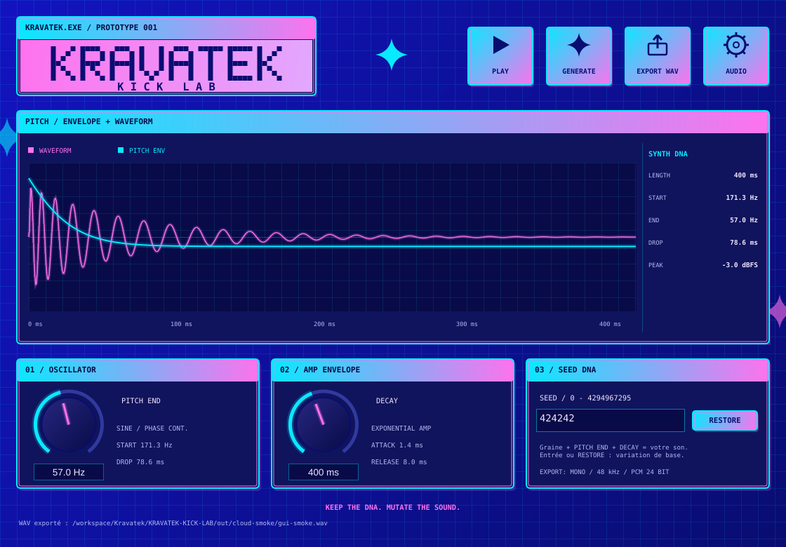

# KRAVATEK KICK LAB — PROTOTYPE 001

**KEEP THE DNA. MUTATE THE SOUND.**

Premier synthétiseur de kick autonome, en C++20 et JUCE. Le son est calculé depuis une sinusoïde : aucun sample externe. La cible utilisateur est Windows 10/11 x64. Ce prototype n'est pas encore un plugin VST3.



La direction visuelle suit la référence du créateur : [style néon et fenêtres rétro](docs/DESIGN.md).

## Utiliser le prototype sous Windows

Si vous avez reçu le paquet Windows, décompressez-le et double-cliquez sur **KravatekKickLab.exe**. Aucun fichier de code n'est à modifier.

| Commande | Fonction |
| --- | --- |
| PLAY | Écoute le kick affiché. Un nouveau clic éteint brièvement la lecture précédente avant de relancer. |
| GENERATE | Crée une variation et affiche sa nouvelle graine. |
| PITCH END | Change la fréquence finale, de 30 à 90 Hz. |
| DECAY | Change la durée totale de décroissance, de 100 à 800 ms. |
| EXPORT WAV | Enregistre le kick affiché en WAV mono PCM 24 bits / 48 kHz. Choisir un nom terminé par `.wav`. |
| SEED | Entrer une graine entre 0 et 4294967295, puis appuyer sur Entrée pour restaurer sa variation de base. |
| AUDIO | Choisit une sortie du système ou réessaie la sortie par défaut. |

La graine **1** restaure la référence : 170 → 52 Hz, descente principale de 60 ms, durée de 320 ms. Après GENERATE, les modifications manuelles de PITCH END et DECAY complètent la graine ; la graine seule restaure les valeurs de base. Les paramètres complets sont inscrits dans les métadonnées du WAV.

La forme d'onde représente le rendu exporté. La lecture utilise le même moteur, recalculé à la fréquence réelle de la sortie audio. Le niveau de crête reste à −3 dBFS.

Pour utiliser un kick dans **FL Studio**, faites glisser le fichier WAV exporté dans un Sampler ou dans la Playlist. La lecture dans FL Studio et sur un périphérique physique reste à valider par écoute.

## Obtenir l'exécutable sans compiler sur votre ordinateur

Le dépôt contient une compilation **GitHub Actions / Windows 2022 / Visual Studio 2022 / MSVC x64** dans `.github/workflows/windows.yml`. Elle devient utilisable après publication des sources sur GitHub.

1. Ouvrir le dépôt GitHub, puis **Actions**.
2. Ouvrir **Windows prototype** et sélectionner une exécution terminée avec succès. Une publication de code déclenche automatiquement la compilation.
3. Dans **Artifacts**, télécharger **KRAVATEK-KICK-LAB-Windows-x64**.
4. Décompresser l'archive, puis ouvrir **KravatekKickLab.exe**.

Le paquet contient l'application, un outil d'export en ligne de commande et un kick de référence. Les tests DSP et un test fonctionnel de l'interface doivent réussir avant la création du paquet. La présence de la configuration ne prouve pas qu'une compilation Windows a déjà été exécutée : voir le [rapport de validation](docs/VALIDATION.md).

## Compilation Windows locale

Prérequis : Git, **Visual Studio 2022** avec **Développement Desktop en C++**, MSVC v143, Windows SDK 10/11 et CMake ≥ 3.22. L'installation de ces outils n'est pas effectuée automatiquement.

Double-cliquer sur **build-windows.cmd** dans ce dossier. Le script configure, compile et teste. Il indique l'emplacement de l'application :

```text
KRAVATEK-KICK-LAB/build/windows-x64/Release/KravatekKickLab.exe
```

Pour un développeur, les commandes équivalentes sont :

```powershell
cmake --preset windows-x64
cmake --build --preset windows-release
ctest --preset windows-release
```

JUCE est téléchargé depuis son dépôt officiel, à un commit fixé. MinGW n'est pas pris en charge par la version JUCE retenue.

## Développement et vérification dans ce cloud Linux

Depuis `/workspace/Kravatek/KRAVATEK-KICK-LAB` :

```bash
python3 tools/setup_cloud.py
python3 tools/run_cloud_smoke.py
```

Le premier script prépare CMake, Ninja, JUCE et les en-têtes de développement dans `/workspace/.kravatek-tools`, compile `build-linux/KravatekKickLab` et exécute les 14 tests. Il télécharge des paquets Debian signés et les extrait localement ; il n'installe rien dans le système. Les vérifications TLS, signatures et sommes de contrôle restent actives.

Le second script démarre temporairement un affichage virtuel et une sortie ALSA silencieuse, teste les commandes de l'interface et l'export, puis arrête son affichage. Résultats : `out/cloud-smoke/`. Ce contrôle ne remplace pas une écoute réelle.

Le moteur et les tests peuvent aussi être compilés sans JUCE :

```bash
cmake --preset dsp-only
cmake --build --preset dsp-release
ctest --preset dsp-release
```

Exemple de rendu, depuis le dossier du projet :

```bash
build-linux/kravatek-render --seed 1 --output out/kick.wav
build-linux/kravatek-render --seed 424242 --pitch-end 57 --decay 400 --output out/variation.wav
```

Sans `--seed`, l'outil utilise également la référence. La reproductibilité exacte concerne les mêmes paramètres, la même graine, la même fréquence et les mêmes conditions de calcul ; les bibliothèques mathématiques de deux plateformes peuvent différer aux derniers bits.

## Structure et versions

- `src/dsp/` : moteur, oscillateur, variations déterministes, lecture et export WAV, sans dépendance JUCE.
- `src/app/` : application JUCE, sorties audio, contrôles et forme d'onde.
- `src/cli/` : export du même moteur sans interface.
- `tests/` : tests de synthèse, sécurité audio, WAV et lecture concurrente.
- `tools/` : préparation et test du cloud.
- `docs/` : architecture et résultats réels.

Versions retenues : C++20, JUCE **8.0.16-security** (`ea77444750de45e036e0279bb0291144bf8e3688`), CMake **3.31.6**, Ninja **1.11.1.4**. GCC **14.2.0** a servi à la validation Linux. La cible Windows utilise Visual Studio 2022 / MSVC v143 ; sa version précise sera inscrite dans le journal GitHub Actions lors de l'exécution.

JUCE est une dépendance externe sous licence AGPLv3 ou commerciale : [conditions officielles JUCE 8](https://juce.com/legal/juce-8-licence/). Aucun choix de licence pour les sources propres à KRAVATEK n'est effectué par ce prototype.
